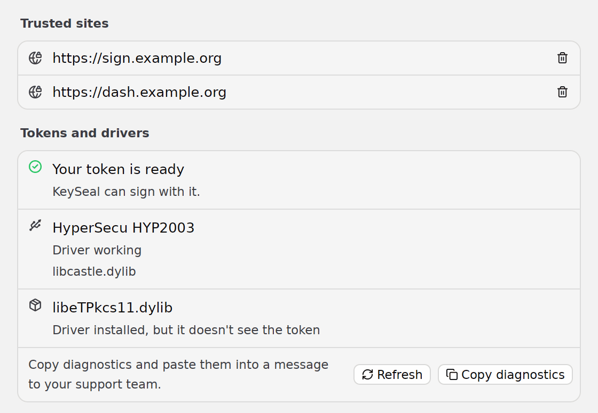
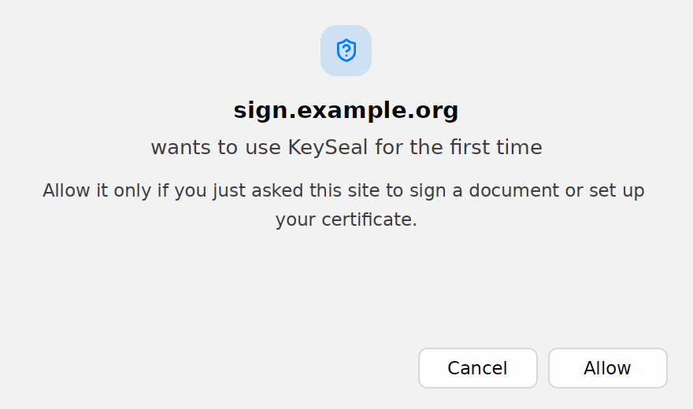
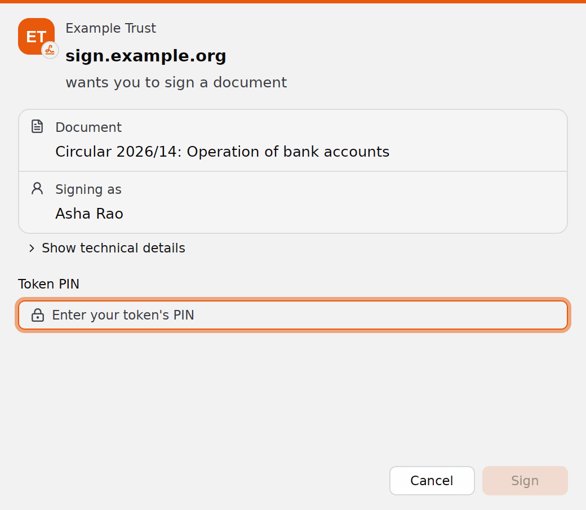
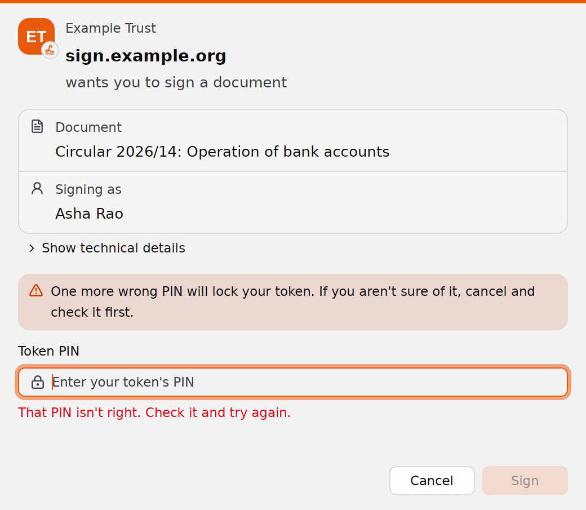

# Signing with KeySeal

A website asked you to sign a document with your USB token or smart card, and sent you here. This guide covers installing KeySeal, the warnings your computer may show while you do, and what you'll see when you sign.

## What KeySeal does

KeySeal is a small app that lets a website use the signing certificate on your token, such as a Digital Signature Certificate (DSC) on a USB token. You install it once. After that, when you click Sign on a website that uses KeySeal, KeySeal opens on its own, shows you which site is asking and what it wants you to sign, asks for your token's PIN and signs.

- **Your PIN stays on your computer.** You type it into KeySeal, and KeySeal gives it only to your token.
- **Your private key never leaves the token.** The token makes the signature; KeySeal only hands it the document's fingerprint.
- **KeySeal talks only to the site that asked you to sign.** It fetches the document and sends back your certificate and the signature, or, if signing fails, the reason.
- **Nothing about you goes to the KeySeal project.** Once a day KeySeal downloads its own updates and a list of token drivers from KeySeal's releases on GitHub, which GitHub sees as an ordinary download.
- **The sites you allowed, your settings and KeySeal's log stay on your computer.**

KeySeal never signs anything you haven't seen and confirmed. It doesn't read your files, and it isn't connected to anything when you aren't signing.

## Install KeySeal

Download the file for your computer and follow the steps for it below. Each file is for the newest release; KeySeal keeps itself up to date after that.

| Computer | Download |
| --- | --- |
| Mac (Apple silicon or Intel) | [keyseal-macos-universal.dmg](https://github.com/somus/keyseal/releases/latest/download/keyseal-macos-universal.dmg) |
| Windows 10 or 11 | [keyseal-windows-x64.zip](https://github.com/somus/keyseal/releases/latest/download/keyseal-windows-x64.zip) |
| Linux, x64 | [AppImage](https://github.com/somus/keyseal/releases/latest/download/keyseal-linux-x64.AppImage) or [Debian/Ubuntu package](https://github.com/somus/keyseal/releases/latest/download/keyseal_amd64.deb) |
| Linux, arm64 | [AppImage](https://github.com/somus/keyseal/releases/latest/download/keyseal-linux-arm64.AppImage) or [Debian/Ubuntu package](https://github.com/somus/keyseal/releases/latest/download/keyseal_arm64.deb) |

Every file, including the Linux tarballs, is also on the [latest release page](https://github.com/somus/keyseal/releases/latest). None of them need administrator rights, except the Debian package.

### Why your computer warns you

KeySeal is new, and its Mac app isn't notarized by Apple and its Windows app isn't signed with a Microsoft-recognised certificate yet. So the first time you open it, macOS or Windows warns that it can't check the app, and you have to allow it once. The steps below show how. The warning is about the missing notarization and signature, not about anything KeySeal does. Both are still to come.

You can check that your download is the one the KeySeal maintainers published. Every release has a file named `SHA256SUMS`, which the maintainers sign, listing each download's SHA-256 fingerprint. Work out your file's fingerprint and look for it in that list:

- Mac: in Terminal, `shasum -a 256 ~/Downloads/keyseal-macos-universal.dmg`
- Windows: in PowerShell, `Get-FileHash $HOME\Downloads\keyseal-windows-x64.zip`
- Linux: `sha256sum keyseal-linux-x64.AppImage`

If the fingerprint isn't in `SHA256SUMS`, don't open the file. The [code signing policy](code-signing-policy.md) says who signs releases and how.

### Mac

1. Open the downloaded `keyseal-macos-universal.dmg`.
2. Drag KeySeal onto the Applications folder in the window that opens, then eject the KeySeal disk.
3. Open KeySeal from your Applications folder. macOS says it can't check KeySeal and doesn't open it. Close that message; don't move KeySeal to the Bin (Trash).
4. Open System Settings, choose **Privacy & Security**, and scroll down to Security. Next to the line about KeySeal, click **Open Anyway**.
5. macOS asks once more. Click **Open**, and enter your Mac's password if it asks for it.

KeySeal opens its settings window. You only need to do this once: from now on, macOS lets KeySeal open whenever a website starts it. Apple's own guide to these steps is [Safely open apps on your Mac](https://support.apple.com/en-us/102445).

Opening KeySeal from Applications is what tells macOS that KeySeal handles signing links, so do it before you click Sign on the website.

### Windows

1. Open your Downloads folder, right-click `keyseal-windows-x64.zip` and choose **Extract All**, then **Extract**. Don't run anything from inside the zip without extracting it first.
2. In the extracted folder, double-click `install.cmd`.
3. Windows may show a blue window, **Windows protected your PC**. Click **More info**, check that the app it names is `install.cmd`, then click **Run anyway**.
4. A black window says KeySeal is installed and registered for keyseal:// links. Press any key to close it.

That's it. KeySeal is installed for your Windows account in `%LOCALAPPDATA%\keyseal`, adds a KeySeal shortcut to the Start menu that opens its settings, and appears under Settings, Apps, Installed apps. You can delete the zip and the extracted folder.

Microsoft explains the warning in [SmartScreen reputation for Windows apps](https://learn.microsoft.com/en-us/windows/apps/package-and-deploy/smartscreen-reputation): it appears for an app that isn't signed, and you choose **Run anyway** to continue. Two things can stop you there:

- **A work computer** may not offer Run anyway at all, because your organisation's policy turns it off. Ask your IT team to install KeySeal for you.
- **Smart App Control**, on some new Windows 11 computers, blocks unsigned apps outright, with no way to allow one app ([Microsoft's page on Smart App Control](https://support.microsoft.com/en-us/topic/what-is-smart-app-control-285ea03d-fa88-4d56-882e-6698afdb7003)). Until KeySeal's Windows app is signed, it can't run on a computer with Smart App Control on. Turning Smart App Control off in Windows Security lowers your computer's protection, so decide that with whoever looks after your computer.

### Linux

The **Debian/Ubuntu package** installs KeySeal for everyone on the computer. Open it with your software installer, or in a terminal run:

```sh
sudo apt install ./keyseal_amd64.deb
```

The **AppImage** installs for you alone and updates itself. In a terminal, in the folder you downloaded it to:

```sh
chmod +x keyseal-linux-x64.AppImage
./keyseal-linux-x64.AppImage install
```

This copies KeySeal to `~/.local/bin/keyseal`, adds it to your app menu and registers it for keyseal:// links. You can delete the downloaded file afterwards. The **tarball** works the same way: extract it and run `./keyseal install` from its folder.

Use the `arm64` file names instead on an arm64 computer. Linux doesn't show a warning for KeySeal.

## Your token's driver

Most tokens need their maker's driver before any app can use them. For a DSC token, it usually comes from the token's maker or from the company that issued your certificate, often as a "token manager" download. Install it as they tell you, then plug in your token.

KeySeal looks for the driver itself. It knows the drivers of the common Indian DSC tokens (such as HYP2003, ePass2003, ProxKey and SafeNet), and works with any token or smart card whose driver follows the PKCS#11 standard. On Windows and Mac it can also use a card the system already understands, such as a PIV card or a YubiKey, without a driver.

To see what KeySeal found, open its settings:

- **Mac:** open KeySeal from your Applications folder.
- **Windows:** open KeySeal from the Start menu.
- **Linux:** open KeySeal from your app menu.

**Tokens and drivers** says whether your token is ready. "Your token is ready" means KeySeal can sign with it. Otherwise it lists each driver: **Driver working**, **Driver installed, but it doesn't see the token**, **Driver didn't work** with the reason, or **Driver not installed**. Plug in your token, wait a moment, and click **Refresh** to check again.

<picture>
  <source media="(prefers-color-scheme: dark)" srcset="signers/settings-dark.png">
  
</picture>

## Signing a document

Here is what happens after you click Sign on the website, in order.

### 1. Your browser asks to open KeySeal

Your browser asks whether the site may open KeySeal (on some Windows computers it says keyseal). Choose **Open KeySeal**, or **Open link**, depending on your browser. Most browsers offer to remember your choice for that site, which saves this step next time.

If nothing happens at all, see [The website can't open KeySeal](#the-website-cant-open-keyseal).

### 2. KeySeal asks about a site it hasn't seen before

The first time a site uses KeySeal, KeySeal asks before it contacts the site:

<picture>
  <source media="(prefers-color-scheme: dark)" srcset="signers/trust-dark.png">
  
</picture>

Check the site's name. If it's the website you just clicked Sign on, click **Allow**. KeySeal remembers it, and doesn't ask again for that site. If you didn't just ask that site for anything, click **Cancel**: KeySeal sends it nothing.

The website may tell you KeySeal didn't open while this window is waiting for you. Answer KeySeal's question; the website carries on once you do.

### 3. Check the document and enter your PIN

KeySeal shows who is asking, the document and the name it signs as. The window can carry the website's own name, logo and colour, but the site's address in bold is always the one KeySeal checked.

<picture>
  <source media="(prefers-color-scheme: dark)" srcset="signers/pin-dark.png">
  
</picture>

- **Document** is the document's title, or for several documents, how many there are and each one's title. You sign them all with one PIN.
- **Signing as** is the name the site gave for the signer.
- **Show technical details** shows the certificate KeySeal will use and each document's fingerprint, if you or your support team want to check them.
- If more than one token is plugged in, KeySeal first asks which one to use, showing each token's name, model and serial number and the names on its certificates. When the website has said which certificate to use, KeySeal picks the token holding it without asking.
- If your token holds more than one certificate, KeySeal asks you to choose one first. Under each name it shows who issued the certificate, until when it is valid and the last digits of its serial number, so after a renewal you can pick the new one.

Type your token's PIN in **Token PIN** and click **Sign**. KeySeal signs, sends the signature to the site and closes. Go back to the website, which shows the result.

A few tokens and cards work differently:

- With a token that has its own keypad, KeySeal tells you to enter the PIN on the token when it asks.
- When the certificate can only be read after the PIN, KeySeal asks for the PIN first and then shows the document once more for you to **Confirm**.
- On Windows, some tokens show their maker's own PIN window, and on a Mac the system shows its own PIN window for a card it understands without a driver. KeySeal shows you the document first and asks you to **Confirm**, then the token's window asks for the PIN.

A site may also ask you to set up your certificate before your first signature. KeySeal then says the site **wants to set up your signing certificate**, and your PIN only unlocks the token so KeySeal can find your certificate.

To stop at any point, click **Cancel** or close the window. Nothing is signed, and the site is told you cancelled.

### If the PIN is wrong

KeySeal says **That PIN isn't right. Check it and try again.**, clears the field, and lets you try again in the same window. Your token counts the wrong tries, and locks itself after a number its maker set. KeySeal reads the count from the token and warns you before it's too late:

- **A wrong PIN was entered before, so only a few tries are left before your token locks.**
- **One more wrong PIN will lock your token. If you aren't sure of it, cancel and check it first.**

<picture>
  <source media="(prefers-color-scheme: dark)" srcset="signers/pin-final-try-dark.png">
  
</picture>

When you see the second warning and aren't sure of your PIN, click **Cancel**. A locked token can only be unlocked with its own software or by whoever issued it, and some can't be unlocked at all. Not every token reports its count, so you may get no warning.

## When something goes wrong

### The website can't open KeySeal

- **KeySeal isn't installed yet**, or on a Mac you haven't opened it from Applications once. Install it as above, then click Sign on the website again. Websites usually keep your signing request open while you install.
- **You chose not to open it** in your browser's prompt. Click Sign again and allow it.
- **KeySeal is waiting for you** behind another window. Look for its window, or for KeySeal in the Dock or taskbar.

### No token or certificate is found

KeySeal says **No token or smart card is plugged in.**, **No token or smart card driver was found.** or **No signing certificate was found on the token.** Check that:

1. The token is plugged in. Try another USB port, and wait a few seconds after plugging it in.
2. The token's driver is installed, and its own software can see the token.
3. **Tokens and drivers** in KeySeal's settings says your token is ready. The error window has a **Tokens and drivers** button that opens it.

If the site expects a particular certificate, KeySeal may say the token **doesn't hold the certificate the job asks for**, or that **none of the certificates on this token are accepted** for this job. Plug in the token the site knows about, or ask the site which certificate it needs.

### The token is locked

KeySeal says **Your token's PIN is locked after too many wrong tries, so KeySeal can't use it.** It can't unlock the token. Use the software that came with your token, or ask whoever issued it. Many DSC tokens can be unlocked with the admin PIN (often called the SO PIN) from the token's own software.

### The certificate has expired

KeySeal doesn't offer an expired certificate. When it's the only one on your token, KeySeal says **The certificate on your token expired on** a date, and to renew it with the company that issued it. If the certificate isn't valid yet, it says from which date you can use it.

### The link is damaged or the job has expired

**The KeySeal link is damaged, so the job can't be opened.** or **The job doesn't exist or has expired.** means the request from the website can't be used any more. Go back to the website and click Sign again.

### KeySeal says it needs a newer version

A site may need a newer KeySeal than you have: KeySeal says the site **needs KeySeal helper** a version **or later**, or that **this helper is too old for the server**. KeySeal fetches the update as soon as it closes; click Sign on the website again and the new version installs as KeySeal starts. If that doesn't work, download and install KeySeal again.

### Getting help

Whoever runs the website you're signing on is the one to ask first; KeySeal is the tool their site uses. To give them the details they need:

1. Open KeySeal's settings (see [Your token's driver](#your-tokens-driver)).
2. Under **Tokens and drivers**, click **Copy diagnostics**.
3. Paste it into your message to them.

The diagnostics list the sites you allowed, your token, its drivers and certificates, and your computer's system and version of KeySeal. They never include your PIN. KeySeal also keeps a log, `keyseal.log`, in the folder shown under **About**, **Config directory**, which you can send as well.

## Updates

KeySeal updates itself. After a website has used it, at most once a day, it checks KeySeal's releases for a newer version and downloads it. It checks that the maintainers signed the update before using it, and installs it the next time a website starts it. You don't need to do anything.

There are three exceptions, where KeySeal shows a window telling you about a new version instead:

- **Mac, without an administrator account:** KeySeal can't replace itself in Applications. The window says where it saved the new version; open that file and drag KeySeal to Applications, replacing the old one.
- **Linux, from the Debian package or the tarball:** install the new version from the [latest release](https://github.com/somus/keyseal/releases/latest) the way you installed the first one. The AppImage updates itself.
- **Linux, an AppImage in a folder you can't write to:** the window says where KeySeal saved the new version, to copy over the old one.

## Uninstalling

**Mac:** quit KeySeal, then drag it from Applications to the Bin (Trash). Your list of allowed sites, settings and log stay in `~/Library/Application Support/keyseal`; delete that folder too to remove them.

**Windows:** open Settings, Apps, Installed apps, and choose **Uninstall** on KeySeal. If KeySeal isn't listed there, press Windows+R, type the line below and press Enter:

```
%LOCALAPPDATA%\keyseal\keyseal.exe uninstall
```

Either way, KeySeal removes its Start menu shortcut and its folder. Your allowed sites, settings and log stay in `%APPDATA%\keyseal`; delete that folder too to remove them.

**Linux:** for the Debian package, run `sudo apt remove keyseal`. For the AppImage or the tarball, run `~/.local/bin/keyseal uninstall`. Your allowed sites, settings and log stay in `~/.config/keyseal`.

To stop trusting one site without uninstalling, open KeySeal's settings and click the bin icon (**Forget**) next to it under **Trusted sites**.
